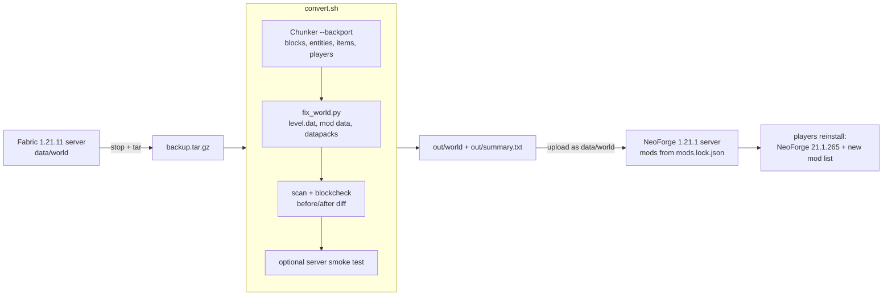

# minecraft-1.21.1-backport

A toolkit to move a modded Minecraft Java world from **Fabric 1.21.11** back to **NeoForge 1.21.1**, plus the notes
needed to host the result and update the client installer.

## Why

Our server ran Fabric 1.21.11 with community ports of Create Aeronautics, Sable and Offroad. The official Create
Aeronautics and Offroad releases exist for **NeoForge 1.21.1**, so that is where we are moving. Minecraft cannot
open a world saved by a newer version, so a plain copy of the world does not work. This repo patches
[Chunker](https://github.com/HiveGamesOSS/Chunker) (by Hive Games, MIT) so it can write a 1.21.1 world while keeping
modded data, then fixes up what Chunker cannot do (`level.dat`, mod saved data, Create train graphs, Waystones,
Traveler's Backpack backups, graves).

**Read [docs/KNOWN-GAPS.md](docs/KNOWN-GAPS.md) first: Sable sub-levels (airships and cars) are not converted yet.**

## Flow



## Quick start

Needs Java 21, Python 3, `curl`, and disk space of about 3x the world.

```sh
git clone https://github.com/KiraKami-dev/minecraft-1.21.1-backport.git
cd minecraft-1.21.1-backport

# 1. convert a backup (a .tar.gz of the world folder, or a world directory)
./convert.sh ~/backups/world-final.tar.gz ~/backport-out

# 2. read the result
less ~/backport-out/summary.txt

# 3. get the server mods (sha512-verified against mods/mods.lock.json)
scripts/download-mods.sh server ./server/mods
```

`convert.sh` never modifies its input. The converted world is `<out>/world`. Full walkthrough:
[docs/BACKPORT.md](docs/BACKPORT.md).

## Docs

| doc | what |
|---|---|
| [docs/BACKPORT.md](docs/BACKPORT.md) | step by step: final backup, convert, read the summary, smoke test |
| [docs/WHAT-CHANGES.md](docs/WHAT-CHANGES.md) | every substitution the converter makes (blocks, items, entities, biomes, dropped mods) |
| [docs/KNOWN-GAPS.md](docs/KNOWN-GAPS.md) | what is not converted or only load-tested |
| [docs/HOSTING.md](docs/HOSTING.md) | run the NeoForge 1.21.1 server (itzg + lazymc + playit) and the cutover checklist |
| [docs/CLIENT.md](docs/CLIENT.md) | changes to the friends' client installer (A1K2S3/minecraft) and TLauncher notes |

## Layout

```
convert.sh               the pipeline (arguments: <backup.tar.gz | world dir> <out dir>)
backport-settings.json   settings passed to Chunker --backport
chunker/                 patched Chunker, full upstream history plus our backport commits (MIT, see chunker/LICENSE)
  cli/src/main/java/com/hivemc/chunker/conversion/encoding/java/backport/   the backport code
scripts/                 Python NBT tools (nbt, scan, cmp, blockcheck, biomes, fix_world, summary, ...) and
                         download-mods.sh, server_smoke.sh
examples/tlauncher/      example swap scripts for TLauncher (macOS)
mods/mods.lock.json      every mod: Modrinth project, version id, filename, sha512, side
docs/
```

Mod jars are **not** in the repo (redistribution licenses). `scripts/download-mods.sh <server|client> <dest>`
fetches them from Modrinth and checks every sha512.

## Credits and licensing

- **Chunker** by [Hive Games](https://github.com/HiveGamesOSS/Chunker), MIT License. `chunker/` is a fork with its
  git history kept; the license is `chunker/LICENSE`. Our changes are the commits that touch
  `cli/.../java/backport/` and the `--backport` options of the CLI.
- `chunker/cli/src/main/resources/backport/trial-spawner-configs.json` (about 10 KB, data only) was extracted from
  Minecraft 1.21.11 game data; it is the vanilla trial spawner configs (`data/minecraft/trial_spawner`), which
  1.21.2+ references by registry name and 1.21.1 expects inline in the block entity. `vb-blocks.txt` next to it lists the block ids Vanilla Backport adds
  (regenerate with `scripts/gen_vb_blocks.py`).
- Minecraft is a trademark of Mojang/Microsoft. This project is not affiliated with Mojang, Hive Games or any mod author.
